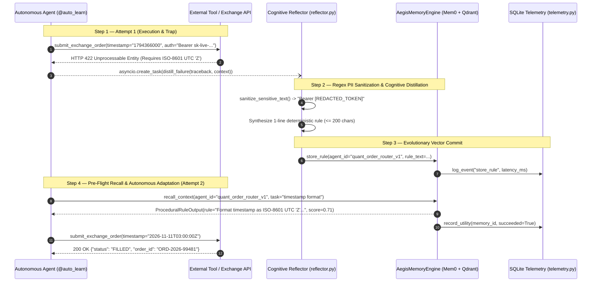

# 🛡️ aegis-mem: Self-Evolving Procedural Agent Memory

[](https://www.python.org/)
[](https://github.com/jlowin/fastmcp)
[](https://fastapi.tiangolo.com/)
[](https://qdrant.tech/)

**`aegis-mem`** is a production-grade procedural and episodic memory engine powered by **Mem0** and **Qdrant**. Rather than storing passive chat transcripts, `aegis-mem` intercepts runtime exceptions, scrubs credentials/PII via regex, distills failures into deterministic **1-line procedural rules ($\le 200$ chars)**, and injects them during pre-flight recall so autonomous agents never repeat the same mistake twice.

---

## 🔄 Autonomous Self-Reflection Loop



---

## ✨ Key Capabilities

- **Strict Layer Separation & Scoping**: Every memory operation enforces `agent_id`, `user_id`, or `run_id` isolation. Unbounded global queries are rejected at the schema and engine levels.
- **Zero-Leakage Reflection (`core/reflector.py`)**: Automatically redacts Bearer tokens, `sk-*` API keys, AWS keys, connection string passwords, and email addresses before passing stacktraces to any LLM.
- **Async-First Architecture (`core/engine.py`)**: Wraps synchronous `mem0ai` vector operations in `asyncio.to_thread()` and dispatches failure distillation in background tasks (`asyncio.create_task` / FastAPI `BackgroundTasks`) with zero blocking latency.
- **Dual Interfaces (`interfaces/`)**:
  - **FastMCP Server (`mcp_server.py`)**: Exposes `get_procedural_memories`, `record_execution_failure`, and `commit_learned_fact` over stdio/SSE.
  - **FastAPI Cloud Service (`cloud_api.py`)**: Exposes `/v1/memories/recall`, `/v1/memories/reflect` (`202 Accepted`), `/v1/memories/commit`, and `/health`.
- **Decorator Trap (`utils/decorators.py`)**: Drop-in `@auto_learn(agent_id="...")` decorator that wraps any Python function with automatic exception trapping and background lesson synthesis.

---

## 🚀 Quickstart

### 1. Install Dependencies

```bash
pip install -e ".[dev]"
```

### 2. Run the Live Self-Learning Demo (100% Offline)

Experience the 3-step self-healing loop (Failure Trap $\rightarrow$ Secret Redaction & Rule Distillation $\rightarrow$ Pre-Flight Recall & Adaptation) using in-memory Qdrant (`:memory:`):

```bash
python examples/live_self_learning_demo.py
```

### 3. Run the Test Suite

All unit and integration tests run offline against `QdrantClient(location=":memory:")` with zero external API cost:

```bash
pytest -v
```

### 4. Configure as an IDE / Claude Desktop MCP Server

Add the following entry to your `claude_desktop_config.json` or IDE MCP settings (`.cursor/mcp.json` / Antigravity MCP config):

```json
{
  "mcpServers": {
    "aegis-mem": {
      "command": "python",
      "args": ["-m", "aegis_mem.interfaces.mcp_server"],
      "env": {
        "AEGIS_QDRANT_IN_MEMORY": "true",
        "AEGIS_COLLECTION_NAME": "aegis_procedural_rules",
        "AEGIS_LLM_PROVIDER": "openai",
        "AEGIS_LLM_MODEL": "gpt-4o-mini",
        "AEGIS_LLM_API_KEY": "sk-your-api-key"
      }
    }
  }
}
```

Or using `uv`:

```json
{
  "mcpServers": {
    "aegis-mem": {
      "command": "uv",
      "args": [
        "--directory",
        "C:/Users/Usuario/Desktop/proyectos/aegis-mem",
        "run",
        "python",
        "-m",
        "aegis_mem.interfaces.mcp_server"
      ]
    }
  }
}
```

---

## 🐳 Production Deployment (Docker Compose)

Launch Qdrant and the `aegis-mem` FastAPI service on port `8000`:

```bash
cp .env.example .env
docker compose up --build -d
curl http://localhost:8000/health
```
